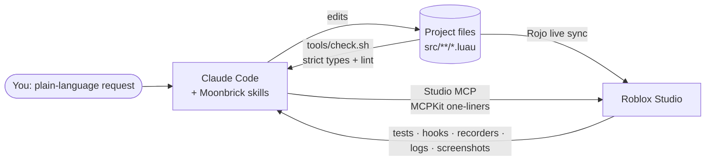

<p align="center">
  
</p>

<p align="center">
  <b>A Claude Code plugin that makes AI genuinely good at Roblox development.</b><br>
  Real files, real type checking, real playtests, and games that don't look like a placeholder.
</p>

<p align="center">
  <a href="LICENSE"></a>
  <a href="https://github.com/TanaTTV/Moonbrick/releases"></a>
  
  
  
  
</p>

<p align="center">
  <a href="#-showcase">Showcase</a> ·
  <a href="#install">Install</a> ·
  <a href="#-what-you-get">Features</a> ·
  <a href="#-how-it-works">How it works</a> ·
  <a href="#-game-libraries">Libraries</a> ·
  <a href="#-tested-for-real">Testing</a>
</p>

---

## 🎮 Showcase

### Reyna's Leer, end to end

<p align="center">
  
  <br><sub><i>First-person viewmodel, cast choreography, an eye that flies through walls, and Nearsight. Every texture was drawn by code, uploaded, playtested and screenshot-reviewed by Claude.</i></sub>
</p>

## ✨ Why Moonbrick

AI can write Luau, but Roblox development with AI usually goes like this: slow tool calls that dump walls of text, scripts edited blind inside Studio, bugs found only after a playtest, and results that *work* but look low budget.

| Without Moonbrick | With Moonbrick |
|---|---|
| Claude edits scripts through Studio, one slow call at a time | Claude edits **real files**; Rojo syncs them into Studio instantly |
| Bugs show up mid-playtest | **Strict type checking + linting** fail closed before you press Play |
| Testing means clicking around | **Debug hooks**, frame recorders and filtered logs let Claude drive and check features itself |
| Every feature written from scratch, with naive saves | **Ready-made systems**: VFX, UI, secure remotes, session-locked saved data, rounds, cooldowns |
| Claude reads the whole library to learn it | A generated **15 KB API card** and **checked recipes** ship with every project |
| "It works" = done | **Design-first**: reference images, drawn textures, screenshot review |

**What it costs:** in a same-batch benchmark of the same small task, Moonbrick runs cost the same as plain Claude Code ($0.217 vs $0.220 median), finished about **23% faster**, and every one used session-locked saves and validated remotes, which the plain runs didn't. One task and three runs per side, so read the [benchmark](docs/BENCHMARK.md) before quoting it.

<a id="install"></a>

## 📦 Install

You need [Claude Code](https://claude.com/claude-code), [Roblox Studio](https://create.roblox.com/) with the **Studio MCP** enabled (Studio → Assistant settings), Python 3.10+, `git` and `curl`. On Windows, use Git Bash. Blender is optional.

In Claude Code:

```text
/plugin marketplace add TanaTTV/Moonbrick
/plugin install moonbrick@moonbrick
/reload-plugins
```

Or from a terminal, for a local checkout:

```bash
claude plugin marketplace add /absolute/path/to/Moonbrick
claude plugin install moonbrick@moonbrick
claude plugin list --json      # shows moonbrick@moonbrick, enabled: true
```

Then start your first game:

```text
/moonbrick:new my-game
```

The first project installs checksum-verified [Rokit](https://github.com/rojo-rbx/rokit) with pinned Rojo, luau-lsp, Selene and StyLua, plus the Rojo Studio plugin. Open Studio → Plugins → **Rojo** → **Connect**, review the connection diff, and ask for what you want ("add a coin shop", "make the ability feel punchier"). Start with the command or say "use Moonbrick": for a terse "make a Roblox game", Claude didn't pick up the skills on its own in our benchmark.

<details>
<summary><b>Upgrading from 0.1 or a beta</b></summary>

```bash
claude plugin marketplace update moonbrick
claude plugin update moonbrick@moonbrick
```

Restart Claude Code or run `/reload-plugins`. Updating the plugin does not touch your games; run `/moonbrick:update` in each game to refresh its bundled Kit (your game files are preserved and backed up). If you install from a local checkout whose version did not change, `claude plugin uninstall moonbrick@moonbrick` then `install` refreshes the cache. `python scripts/test-install.py` verifies fresh install, upgrade, file hashes and scaffolding in isolated directories.
</details>

## 🧰 What you get

### Commands

| Command | What it does |
|---|---|
| `/moonbrick:new` | New game project: Rojo sync, strict types, linting, formatting, tests, debug hooks, API card, recipes, git. Ready in seconds. |
| `/moonbrick:import` | Bring an **existing game** in: its scripts become files via Rojo syncback; your map and terrain stay in the place file. |
| `/moonbrick:playtest` | Verify a feature in a real playtest: unit tests, hook-driven actions, recorded UI/camera/effects, filtered error logs. |
| `/moonbrick:review` | Code, security, performance, mobile/console and **screenshot-based design** review → a prioritized fix list. |
| `/moonbrick:ship` | Pre-publish checklist including player-data safety, then a tagged release. |
| `/moonbrick:update` | Update a project's bundled Moonbrick code to the installed version. |
| `/moonbrick:assets` | Optional Blender workflow: shared art style and budgets, FBX export, and the exact Studio import settings for meshes, PBR and rigs. |

### Skills (load automatically when relevant)

- **`studio`**: the fast, token-efficient way to drive Roblox Studio, plus hard-won gotchas (new avatar joints, flipbook quirks, edit-mode require caching…).
- **`game-systems`**: server authority, exploit-proof remotes, data saving, and pointers to the project's API card and recipes.
- **`game-design`**: design docs, game feel ("juice"), first-time experience, mobile/console support, visual review, fair monetization.

### In every project

- **`tools/KIT_API.md`**: every Kit function with exact signatures, generated from the source (about 15 KB instead of 65 KB of code), so Claude reads less and guesses nothing.
- **`tools/recipes/`**: copy-ready, type-checked features: saved data, coin pickups, a Q / X / touch ability with cooldown and effects, and a shop. CI drops each into a fresh project and builds it.
- **`tools/check.sh`**: strict types + lint in one command; errors stay in order and are capped so one broken file can't flood a session.

### MCPKit (inside Studio)

```lua
local K = require(game.ServerStorage.MCPKit)
K.tree("Workspace", 2)                 -- compact tree instead of 20 KB of JSON
K.test()                               -- run unit tests: "61 passed, 0 failed"
K.hook("Shop", "buy")                  -- drive a feature without clicking
K.record("ui", fn) ; K.results("ui")   -- capture what happened, frame by frame
K.logs()                               -- only warnings/errors since the mark
K.audit()                              -- deprecated APIs, unvalidated remotes, console-unfriendly input
K.toModelJson("Workspace.Map")         -- export Studio-built objects to Rojo files
```

## 🔭 How it works



- **Code lives in files.** Rojo mirrors managed files into Studio. Imported Workspace, terrain and lighting stay in the original place. Always review the connection diff.
- **Studio is for building and testing.** MCP calls go through MCPKit one-liners; playtests are driven by Studio-only debug hooks, not fragile mouse simulation.
- **Everything is checked.** Strict Luau types, Selene lint, unit tests in a real server VM, and screenshots for anything visual.
- **A session hook keeps `rojo serve` running** for whichever project you open.

<details>
<summary><b>Project layout</b></summary>

```text
src/server/   -> ServerScriptService.Server        src/kit/shared/  -> ReplicatedStorage.Kit
src/client/   -> StarterPlayerScripts.Client       src/kit/server/  -> ServerScriptService.Kit
src/shared/   -> ReplicatedStorage.Shared          tests/           -> ServerStorage.Tests
src/world/    -> Workspace.World                   tools/MCPKit.luau -> ServerStorage.MCPKit
```
</details>

## 🧱 Game libraries

Copied into every project under `src/kit/`, so your game never depends on the plugin at runtime.

| Library | What it gives you |
|---|---|
| **VFX** | One-call effects: shockwave, energy sphere, light pillar, bursts, auras, glows, highlights, camera shake, flash, FOV punch, colour-grade spikes, title slams |
| **UI** | Themed buttons, panels, labels and toasts with hover/press/pulse/pop animation, a 48 px touch minimum and gamepad support. Restyle everything from one theme table. |
| **Net** | Remotes with per-argument validation (rejects wrong types, NaN/∞, extra args) and per-player rate limits |
| **PlayerData** | Session-locked saves, retries with backoff, autosave, save on leave and shutdown, template reconcile, nonyielding transactions and a memory-only Studio default |
| **Cooldown / Round / Economy** | Server cooldown gates, a deterministic multiplayer round controller, and validated in-game currency/purchase rules |
| **DebugHooks** | Studio-only actions so tests can drive features without clicking; absent in live games |
| **Fx** | Layered effects (particles, meshes, beams, lights, sound, camera, debris) on one scheduler, with pooling, quality levels, markers and hitstop |
| **Motion / Pose** | Easing, keyframes and springs; procedural R15/R6 poses and short clips with markers |
| **Audio / Tex / Geo** | Sound cues and groups; effect textures; procedural meshes (lathe, torus, tube, extrude) built on clients |

```lua
-- a secure purchase in a few lines
Net.on("Buy", { Net.oneOf("Sword", "Bow") }, function(player, item)
	local bought = false
	PlayerData.update(player, function(data)
		bought = Economy.buy(data, Catalog, item)
	end)
	if bought then
		VFX.burst(player.Character.HumanoidRootPart)
	end
end, { rate = 3 })
```

## 🎨 Design-first

Good-looking games come from a direction, not defaults:

1. **A short brief.** At most three questions (the moment that matters, references, mood or genre mix), or three contrasting directions if you'd rather pick. It's recorded once in `docs/design.md` and `assets/art.json`, which generate the game's UI theme and effect palette.
2. **References, not copies.** Share screenshots; Claude takes their palette, lighting and silhouettes, never their characters or logos.
3. **Screenshot review.** Claude freezes key moments in Studio, fixes the three biggest weaknesses, and repeats until nothing important is left. Stills can't show motion, so it asks you to watch.

[Designing with Moonbrick →](docs/DESIGNING.md)

<p align="center">
  
  <br><sub><i>Leer's eye and 16-frame anime flame flipbook, drawn with Python and uploaded through Studio. The banner at the top of this page is a Blender scene built by a script in <code>.github/assets/blender/</code>.</i></sub>
</p>

## 🔬 Tested for real

Every change runs host tests, a headless Luau suite (PlayerData, Net, gameplay and the pure parts of the creative modules), strict analysis of the Kit, fresh-scaffold builds of the template and recipes, Rojo import fidelity, and an isolated plugin install/upgrade, on Windows, macOS and Linux.

Beyond CI, the [V1 stable ledger](acceptance/v1-stable/) records what was checked in Studio and on live servers, with evidence and what was *not* covered: Blender mesh/PBR/rig import, terrain import, streaming in and out, and player disconnects and server shutdowns during loads and saves. Live DataStore session locking passed 7/7 in a private test experience during the beta ([ledger](docs/V1-BETA-LEDGER.md)).

## 🗺 Roadmap

- [ ] **Safe Creator Store assets:** search and insert with quarantine, a backdoor scan and export to files
- [ ] **Community kit library:** share and install reusable systems (shops, abilities, round loops) as kits
- [ ] Design-review rubric, lighting presets, and the texture generator as a reusable tool
- [ ] **v1.2:** real-device touch/gamepad, 2-player streaming and the remaining live DataStore scenarios ([waived for 1.0](acceptance/v1-stable/WAIVERS.md))
- [x] Blender → Studio mesh, PBR and rig import, with the exact importer settings documented
- [x] API card and checked recipes in every project
- [x] Creative engine (Fx, Motion, Pose, Audio, Tex, Geo) and creative brief (V1.1)

See [ROADMAP.md](ROADMAP.md) for details.

## 🤝 Contributing

Issues and PRs are welcome; see [CONTRIBUTING.md](CONTRIBUTING.md). Found a Roblox gotcha that cost you an hour? Add it to the `studio` skill so nobody else loses that hour.

## 🙏 Built on

[Rojo](https://rojo.space) · [Rokit](https://github.com/rojo-rbx/rokit) · [luau-lsp](https://github.com/JohnnyMorganz/luau-lsp) · [selene](https://github.com/Kampfkarren/selene) · [StyLua](https://github.com/JohnnyMorganz/StyLua) · [Blender](https://www.blender.org) · [Claude Code](https://claude.com/claude-code) · the Roblox Studio MCP

<p align="center"><sub>MIT © TanaTTV · Not affiliated with Roblox Corporation, Nintendo or Anthropic.</sub></p>
