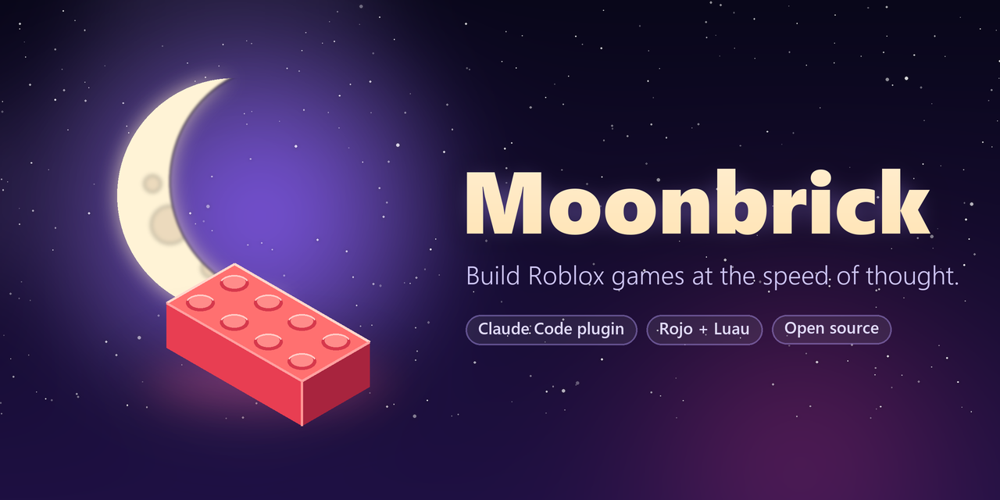
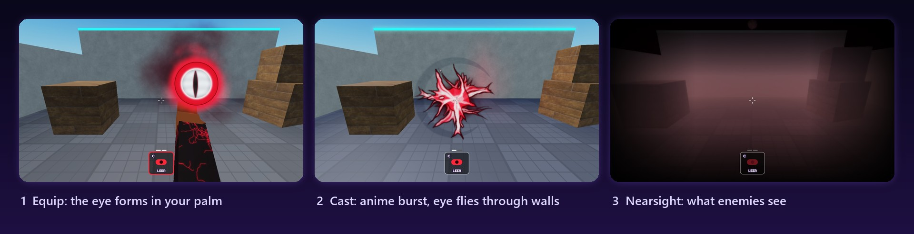
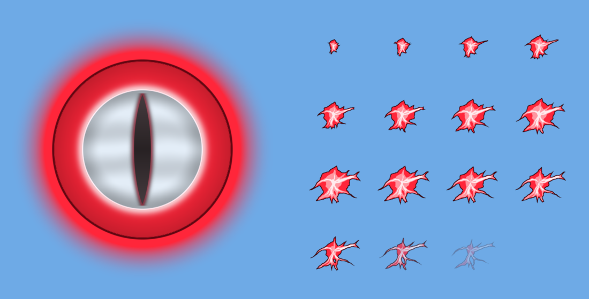

<p align="center">
  
</p>

<p align="center">
  <b>A Claude Code plugin that makes AI genuinely good at Roblox development.</b><br>
  Real files, real type checking, real playtests, and visuals that don't look like a placeholder.
</p>

<p align="center">
  <a href="LICENSE"></a>
  
  
  
  
  
</p>

<p align="center">
  <a href="#install">Install</a> ·
  <a href="#-what-you-get">Features</a> ·
  <a href="#-how-it-works">How it works</a> ·
  <a href="#-game-libraries">Libraries</a> ·
  <a href="#-roadmap">Roadmap</a>
</p>

---

<p align="center">
  
  <br><sub><i>Reyna's Leer from Valorant, built end-to-end with Moonbrick: first-person viewmodel, cast choreography, an eye that flies through walls, and Nearsight. Every texture was drawn by code, uploaded, playtested and screenshot-reviewed by Claude.</i></sub>
</p>

## ✨ Why Moonbrick

AI can write Luau, but Roblox development with AI usually goes like this: slow tool calls that dump walls of text, scripts edited blind inside Studio, bugs found only after a playtest, and results that *work* but look low budget.

Moonbrick fixes the workflow end to end:

| Without Moonbrick | With Moonbrick |
|---|---|
| Claude edits scripts through Studio, one slow call at a time | Claude edits **real files**; Rojo syncs them into Studio instantly |
| Bugs show up mid-playtest | **Strict type checking + linting** fail closed before you press Play |
| Testing requires repeated manual inspection | Debug hooks, bounded UI/camera/effect recorders and filtered logs support batched checks |
| Hierarchy inspection returns detailed paths/relationships | Compact tree output used **89.2% fewer characters** in a controlled fixture; [timings and limits](docs/BENCHMARKS.md) |
| Every feature written from scratch | **Ready-made systems**: VFX, UI, secure remotes, saved data |
| "It works" = done | **Design-first**: reference images, drawn textures, screenshot review |

<a id="install"></a>

## 📦 Install / Upgrade

You need [Claude Code](https://claude.com/claude-code), [Roblox Studio](https://create.roblox.com/) with the **Studio MCP** enabled (Studio → Assistant settings), Python 3.10+, `git` and `curl`. On Windows, use Git Bash. Blender is optional.

Install a local checkout with the non-model Claude Code CLI (verified on 2.1.296):

```bash
claude plugin marketplace add /absolute/path/to/Moonbrick
claude plugin install moonbrick@moonbrick
claude plugin list --json
```

The list must show `moonbrick@moonbrick` with `enabled: true`. In a Claude Code session you can also add the published marketplace with `/plugin marketplace add TanaTTV/Moonbrick`, then `/plugin install moonbrick@moonbrick`. The acceptance test uses a local checkout, not the remote marketplace.

**Upgrading an installed 0.1.0 copy:** point the same marketplace at the new source, refresh it, then update:

```bash
claude plugin marketplace add /absolute/path/to/Moonbrick   # or keep TanaTTV/Moonbrick
claude plugin marketplace update moonbrick
claude plugin update moonbrick@moonbrick
claude plugin list --json
```

The version changed (0.1.0 → 1.0.0-beta.1), so `update` replaces the cached copy; the acceptance test checks that no 0.1.0 file survives. Restart Claude Code or run `/reload-plugins` to load the new skills/hooks. Updating the plugin does not migrate existing games; run `/moonbrick:update` in each game afterward. If you install from a local checkout whose version did not change, `update` keeps the old cached files (Claude Code 2.1.296): `claude plugin uninstall moonbrick@moonbrick` then `install` refreshes it.

Run `python scripts/test-install.py` to verify isolated fresh installation, an actual `v0.1.0` plugin upgrade, exact installed file hashes, empty-cache tool setup, scaffolding/check/build from the installed cache, and SessionStart. It uses temporary Claude/home/tool directories, stops its own Rojo server, cleans up, and checks the real plugin directory's listing/mtimes. `--skip-tools` checks installation/upgrade and scaffolding without tool downloads or the positive server test. Neither mode starts a Claude model session. Actual in-session `/reload-plugins` and the remote marketplace are separate manual checks.

Then start your first game in Claude Code:

```text
/moonbrick:new my-game
```

Start with the command (or say "use Moonbrick"): in our benchmark, Claude did not pick up the skills on its own for a terse "make a Roblox game" request ([details](docs/BENCHMARK.md)). Inside a Moonbrick project, the generated `CLAUDE.md` points it at the skills.

The first project installs checksum-verified [Rokit](https://github.com/rojo-rbx/rokit) 1.2.0 and pinned Rojo/luau-lsp/Selene/StyLua, plus the Rojo Studio plugin. Open Studio → Plugins → **Rojo** → **Connect**, and review the connection diff. The development branch contains unreleased V1 work; [current evidence and release gates](docs/V1-STATUS.md) distinguish local checks from production readiness.

## 🧰 What you get

### Commands

| Command | What it does |
|---|---|
| `/moonbrick:new` | New game project: Rojo sync, strict types, linting, formatting, tests, debug hooks, git. Ready in seconds. |
| `/moonbrick:import` | Bring an **existing game** in: its scripts become files via Rojo syncback; your map stays in the place file. |
| `/moonbrick:playtest` | Verify a feature in a real playtest: unit tests, hook-driven actions, recorded UI/camera/effects, filtered error logs. |
| `/moonbrick:review` | Code, security, performance, mobile/console and **screenshot-based design** review → a prioritized fix list. |
| `/moonbrick:ship` | Pre-publish checklist including player-data safety, then a tagged release. |
| `/moonbrick:update` | Update a project's bundled Moonbrick code to the installed version. |
| `/moonbrick:assets` | Optional native Blender workflow: shared art style/budgets, local FBX export, source hashes and Studio import review. |

### Skills (load automatically when relevant)

- **`studio`**: the fast, token-efficient way to drive Roblox Studio, plus hard-won gotchas (new avatar joints, flipbook quirks, edit-mode require caching…).
- **`game-systems`**: server authority, exploit-proof remotes, data saving, and recipes (purchases, cooldowns, pickups, round loops).
- **`game-design`**: design docs, game feel ("juice"), first-time experience, mobile/console support, visual review, fair monetization.

### MCPKit (inside Studio)

A Luau helper that makes every MCP call short and its output tiny:

```lua
local K = require(game.ServerStorage.MCPKit)
K.tree("Workspace", 2)                 -- compact tree instead of 20 KB of JSON
K.test()                               -- run unit tests: "18 passed, 0 failed"
K.hook("Leer", "cast")                 -- drive a feature without clicking
K.record("ui", fn) ; K.results("ui")   -- capture what happened, frame by frame
K.logs()                               -- only warnings/errors since the mark
K.audit()                              -- deprecated APIs, unvalidated remotes, console-unfriendly input
K.toModelJson("Workspace.Map")         -- export Studio-built objects to Rojo files
```

## 🔭 How it works


- **Code lives in files.** Rojo mirrors managed files into Studio. Service boundaries preserve unknown content; mapped folders are owned by their files. Imported Workspace/terrain/lighting stay in the original place. Always review the connection diff, including same-name object collisions.
- **Studio is for building and testing.** MCP calls go through MCPKit one-liners; playtests are driven by Studio-only debug hooks, so no fragile mouse simulation.
- **Everything is checked.** Strict Luau types, selene lint, unit tests in a real server VM, and screenshots for anything visual.
- **A session hook keeps `rojo serve` running** for whichever project you open.

<details>
<summary><b>Project layout</b></summary>

```text
src/server/   -> ServerScriptService.Server        src/kit/shared/  -> ReplicatedStorage.Kit
src/client/   -> StarterPlayerScripts.Client       src/kit/server/  -> ServerScriptService.Kit
src/shared/   -> ReplicatedStorage.Shared          tests/           -> ServerStorage.Tests
src/world/    -> Workspace.World                   tools/MCPKit.luau -> ServerStorage.MCPKit
```
</details>

## 🎮 Game libraries

Copied into every project under `src/kit/`, so your game never depends on the plugin at runtime.

| Library | What it gives you |
|---|---|
| **VFX** | One-call effects: shockwave, energy sphere, light pillar, bursts, auras, glows, highlights, camera shake, flash, FOV punch, colour-grade spikes, title slams |
| **UI** | Themed buttons, panels, labels and toasts with hover/press/pulse/pop animation, a 48 px touch minimum and gamepad support. Restyle everything from one theme table. |
| **Net** | Remotes with per-argument validation (rejects wrong types, NaN/∞, extra args) and per-player rate limits |
| **PlayerData** | Session tokens, serialized snapshot saves, retries, shutdown tracking, template reconcile, nonyielding transactions and a memory-only Studio default |
| **Cooldown / Round / Economy** | Server cooldown gates, a deterministic multiplayer round controller, and validated in-game currency/purchase rules |
| **DebugHooks** | Studio-only actions so tests can drive features without clicking; absent in live games |

```lua
-- a secure purchase in a few lines
Net.on("Buy", { Net.oneOf("Sword", "Bow") }, function(player, item)
	local data = PlayerData.get(player)
	if not data or data.Coins < Shop[item].price then return end
	PlayerData.update(player, function(d) d.Coins -= Shop[item].price; table.insert(d.Inventory, item) end)
	VFX.burst(player.Character.HumanoidRootPart)
end, { rate = 3 })
```

Game libraries are strictly typed and have specs under `tests/kit/`. Dynamic MCPKit inspection is explicitly nonstrict and linted. [Validation instructions](docs/DEVELOPMENT.md) cover host/headless/isolated Studio tests; real multi-client and provider gates remain separate.

## 🎨 Design-first

Good-looking games come from art, not code. Moonbrick's design workflow:

1. **Reference first.** Share screenshots of what you want; they drive every decision.
2. **Images over primitives.** Effects are built from textures on particles and billboards, drawn by code and uploaded to your account, or taken from vetted packs.
3. **Screenshot review.** Claude captures key moments in Studio (edit or play mode), compares them against your references, and fixes what's off before calling anything done.

<p align="center">
  
  <br><sub><i>Leer's eye and 16-frame anime flame flipbook, drawn with Python and uploaded through Studio.</i></sub>
</p>

## 🗺 Roadmap

- [ ] **Safe Creator Store assets:** search and insert with quarantine, a backdoor scan and export to files
- [ ] **Community kit library:** share and install reusable systems (shops, abilities, round loops) as kits
- [ ] Design-review rubric, lighting presets, and the texture generator as a reusable tool
- [x] Optional native Blender → FBX export with budgets/source hashes and actual Blender static-prop round-trip tests
- [ ] Blender FBX → Studio rendered mesh/rig/PBR import acceptance
- [ ] Verified macOS run (scripts are written for it; reports welcome)

See [ROADMAP.md](ROADMAP.md) for details.

Try the buildable [Crystal Rush example](examples/crystal-rush/README.md): `python scripts/create-example.py <new-folder>`. It exercises rounds, pickups, cooldowns, saved coins, server-fed UI and debug hooks; rendered gameplay acceptance is documented separately.

## 🤝 Contributing

Issues and PRs are welcome; see [CONTRIBUTING.md](CONTRIBUTING.md). Found a Roblox gotcha that cost you an hour? Add it to the `studio` skill so nobody else loses that hour.

## 🙏 Built on

[Rojo](https://rojo.space) · [Rokit](https://github.com/rojo-rbx/rokit) · [luau-lsp](https://github.com/JohnnyMorganz/luau-lsp) · [selene](https://github.com/Kampfkarren/selene) · [StyLua](https://github.com/JohnnyMorganz/StyLua) · [Claude Code](https://claude.com/claude-code) · the Roblox Studio MCP

<p align="center"><sub>MIT © TanaTTV · Not affiliated with Roblox Corporation or Anthropic.</sub></p>
